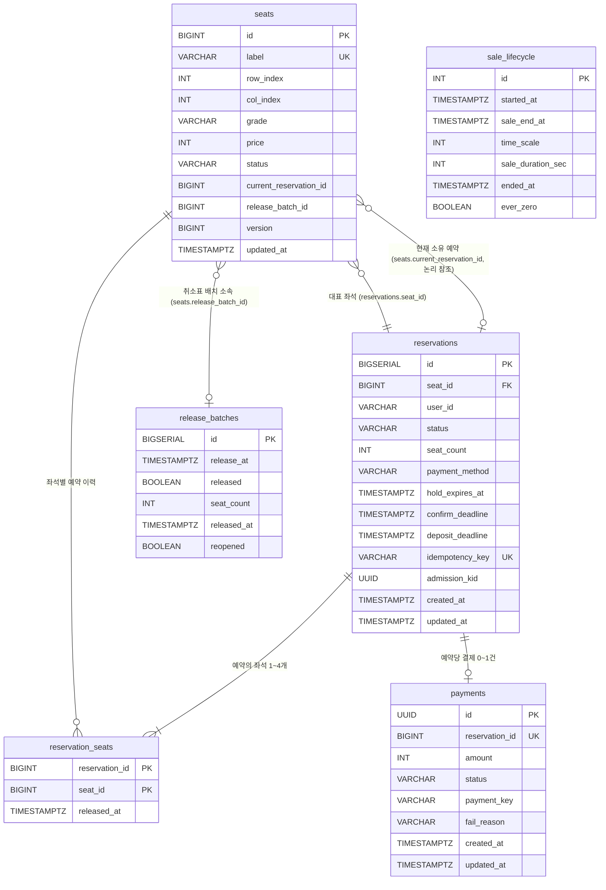
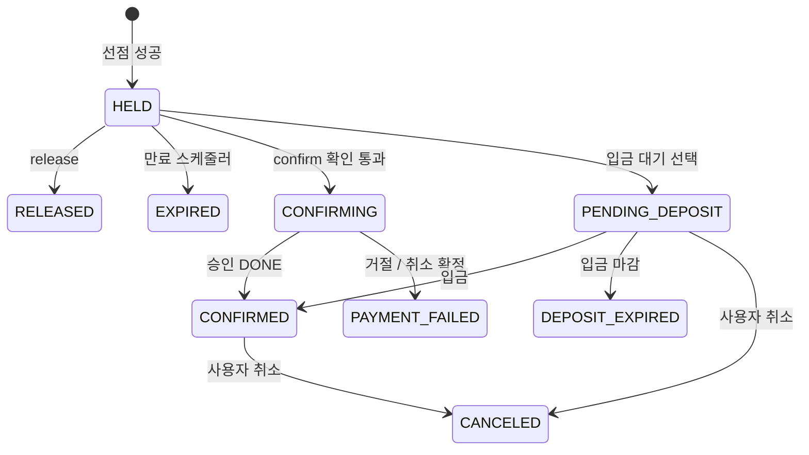

# reservation-sim DB 명세

> 기준 문서는 `SPEC.md`(1.4.1)다. 이 문서는 SPEC의 4·5·6장과 15장을 테이블·컬럼·쿼리 단위로 펼친 것이다. 둘이 다르면 **SPEC.md가 맞고** 이 문서를 고친다.
> 컬럼·제약·인덱스는 Flyway 마이그레이션(`server/src/main/resources/db/migration/V1~V3`)과 일치시킨다. SPEC 5.1에 없는 세부(NULL 여부, 외래키, 보조 테이블 `sale_lifecycle` 등)는 이 문서가 정한다.

---

## 1. 개요

| 항목 | 값 |
|---|---|
| DBMS | PostgreSQL 17 (Docker Compose `postgres:17`) |
| DB 이름 | `reservation` (접속 계정은 `docker-compose.yml` 값) |
| 사용하는 서비스 | **예약 서버만**. 대기열 서버·모의 결제사·시뮬레이터는 DB를 쓰지 않는다 (9장) |
| 스키마 관리 | Flyway (`V1`, `V1_1`, `V2`, `V2_1`, `V3`). JPA는 `ddl-auto: validate`, `open-in-view: false` |
| 동적 DDL | backstop 부분 유니크 인덱스 2개만 애플리케이션이 만들고 지운다 (5.2) |
| 격리 수준 | PostgreSQL 기본 READ COMMITTED. 동시성 제어는 격리 수준이 아니라 조건부 UPDATE·행 잠금·advisory lock으로 한다 (6장). 예외: 스냅샷 읽기는 REPEATABLE READ (6.8) |
| 시각 | 모든 시각 컬럼은 `TIMESTAMPTZ`(UTC). **SQL의 `now()` 금지** — 애플리케이션의 anchor 시계 값을 파라미터 `:now`로 넘긴다 (SPEC 3장) |
| 데이터 수명 | 실행 1회분. `/admin/reset`이 전부 비우고 다시 만든다 (7장) |

---

## 2. ERD



**핵심 관계 규칙**
- **좌석 목록의 기준은 `reservation_seats`**다. `reservations.seat_id`는 대표 좌석(가장 작은 id)일 뿐이다.
- 한 좌석은 여러 예약에 걸쳐 이력이 쌓이지만, **`released_at IS NULL`인 행은 좌석당 최대 1개**다 (불변식 I2′).
- `seats.current_reservation_id`는 빠른 조회용 **논리 참조**다. 외래키를 걸지 않는다 — 좌석과 예약이 서로를 참조하는 순환이 생기고, 반환 시 조건부 UPDATE(`current_reservation_id = :res`)가 소유 확인 역할을 하기 때문이다.
- `seats.release_batch_id`는 `release_batches(id)` 외래키다.
- `sale_lifecycle`은 다른 테이블과 관계없는 1행짜리 판매 시계 테이블이다 (3.6).

---

## 3. 테이블 상세

### 3.1 `seats` — 좌석

| 컬럼 | 타입 | NULL | 기본값 | 제약 | 설명 |
|---|---|---|---|---|---|
| id | BIGINT | N | - | PK | `행 인덱스 × cols + 열 인덱스 + 1` (애플리케이션이 계산, 시퀀스 아님) |
| label | VARCHAR(10) | N | - | UNIQUE | `A1` 형식 (행 문자 + 열 번호) |
| row_index | INT | N | - | - | 0부터 |
| col_index | INT | N | - | - | 0부터 |
| grade | VARCHAR(16) | N | - | - | 등급 이름 (앞줄부터 행 단위 배정) |
| price | INT | N | - | - | 원 단위 |
| status | VARCHAR(16) | N | - | CHECK IN (`AVAILABLE`,`HELD`,`PENDING_DEPOSIT`,`RETURN_PENDING`,`SOLD`) | 4.1 |
| current_reservation_id | BIGINT | Y | NULL | (논리 참조) | AVAILABLE이면 NULL, 그 외 소유 예약(RETURN_PENDING은 끝난 예약 id를 유지) |
| release_batch_id | BIGINT | Y | NULL | FK → release_batches(id) | RETURN_PENDING일 때만 값 |
| version | BIGINT | N | 0 | - | optimistic 전략용 |
| updated_at | TIMESTAMPTZ | N | - | - | `:now`로 갱신 |

행 수: rows × cols (기본 100). reset 때 다시 만든다.

### 3.2 `reservations` — 예약

| 컬럼 | 타입 | NULL | 기본값 | 제약 | 설명 |
|---|---|---|---|---|---|
| id | BIGSERIAL | N | 시퀀스 | PK | |
| seat_id | BIGINT | N | - | FK → seats(id) | 대표 좌석 (가장 작은 id) |
| user_id | VARCHAR(64) | N | - | INDEX `ix_reservations_user` | 사용자 식별 (인증 없음) |
| status | VARCHAR(20) | N | - | CHECK IN (9개, 4.2) | |
| seat_count | INT | N | 1 | CHECK > 0 | 좌석 수 (최대값은 설정 `maxSeatsPerUser`라 CHECK로 고정하지 않음) |
| payment_method | VARCHAR(16) | N | `'CARD'` | CHECK IN (`CARD`,`DEPOSIT`) | 입금 대기 선택 시 `DEPOSIT` |
| hold_expires_at | TIMESTAMPTZ | N | - | INDEX `ix_reservations_status_expiry` (status, hold_expires_at) | 선점 만료 시각 = 생성 + holdTtl |
| confirm_deadline | TIMESTAMPTZ | Y | NULL | - | CONFIRMING 진입 시 = now + confirmDeadlineSec |
| deposit_deadline | TIMESTAMPTZ | Y | NULL | - | PENDING_DEPOSIT 진입 시 = now + depositDeadlineSec |
| idempotency_key | VARCHAR(64) | N | - | UNIQUE `ux_reservations_idempotency` | `POST /holds`의 `Idempotency-Key` |
| admission_kid | UUID | Y | NULL | - | 선점에 쓴 입장키의 kid (`admission.required=false`면 NULL) |
| created_at | TIMESTAMPTZ | N | - | - | |
| updated_at | TIMESTAMPTZ | N | - | - | |

### 3.3 `reservation_seats` — 예약-좌석 연결 (좌석 목록의 기준)

| 컬럼 | 타입 | NULL | 기본값 | 제약 | 설명 |
|---|---|---|---|---|---|
| reservation_id | BIGINT | N | - | PK(1), FK → reservations(id) | |
| seat_id | BIGINT | N | - | PK(2), FK → seats(id), INDEX `ix_reservation_seats_seat` | |
| released_at | TIMESTAMPTZ | Y | NULL | backstop 부분 유니크 (5.2) | 예약이 끝나 좌석을 놓은 시각. NULL = 아직 이 예약이 좌석을 가짐 |

### 3.4 `payments` — 결제 (카드)

| 컬럼 | 타입 | NULL | 기본값 | 제약 | 설명 |
|---|---|---|---|---|---|
| id | UUID | N | - | PK | = orderId (애플리케이션 생성) |
| reservation_id | BIGINT | N | - | UNIQUE, FK → reservations(id) | 예약당 결제 1건 |
| amount | INT | N | - | - | 좌석 가격 합 |
| status | VARCHAR(16) | N | - | CHECK IN (`REQUESTED`,`APPROVED`,`FAILED`,`CANCELED`) | |
| payment_key | VARCHAR(64) | Y | NULL | - | 승인 요청 시 저장 (결제사 발급) |
| fail_reason | VARCHAR(64) | Y | NULL | - | 거절·취소 사유 코드 |
| created_at | TIMESTAMPTZ | N | - | - | |
| updated_at | TIMESTAMPTZ | N | - | - | |

- 입금(DEPOSIT) 예매는 `payments` 행을 만들지 않는다 (가상계좌는 흉내만).

### 3.5 `release_batches` — 취소표 배치

| 컬럼 | 타입 | NULL | 기본값 | 제약 | 설명 |
|---|---|---|---|---|---|
| id | BIGSERIAL | N | 시퀀스 | PK | |
| release_at | TIMESTAMPTZ | N | - | - | 오픈 시각 = 첫 미입금 시각 + returnDelaySec |
| released | BOOLEAN | N | FALSE | - | 오픈 완료 여부 |
| seat_count | INT | N | 0 | CHECK ≥ 0 | 편입된 좌석 수 |
| released_at | TIMESTAMPTZ | Y | NULL | - | 실제로 좌석을 푼 시각 |
| reopened | BOOLEAN | N | FALSE | - | 취소표 오픈 사건으로 풀렸는지 (판매 종료 후 조용히 푼 배치는 FALSE) |

- **열린 배치는 동시에 최대 1개**: 부분 유니크 인덱스 `ux_release_batch_open ON release_batches((TRUE)) WHERE released = FALSE`로 DB가 강제한다. 미입금이 생기면 열린 배치가 있으면 합류, 없으면 새로 만든다.
- phase의 REOPEN 판단(마지막 취소표 오픈 후 `reopenWindowSec` 이내)은 `max(released_at) FILTER (WHERE reopened)`로 구한다.

### 3.6 `sale_lifecycle` — 판매 시계 (1행)

| 컬럼 | 타입 | NULL | 기본값 | 제약 | 설명 |
|---|---|---|---|---|---|
| id | INT | N | - | PK, CHECK (id = 1) | 항상 1행 |
| started_at | TIMESTAMPTZ | N | - | - | 판매 시작 시각 (anchor 기준) |
| sale_end_at | TIMESTAMPTZ | N | - | - | 판매 종료 시각 (시뮬레이터가 보낸 값) |
| time_scale | INT | N | - | CHECK IN (1, 2, 4) | 배속 |
| sale_duration_sec | INT | N | - | CHECK > 0 | 판매 시간 (시뮬레이션 초) |
| ended_at | TIMESTAMPTZ | Y | NULL | - | 판매 종료 처리 시각 |
| ever_zero | BOOLEAN | N | FALSE | - | AVAILABLE이 한 번이라도 0이 됐는지 (phase RUSH 판단, SPEC 6.12) |

- reset 때 `INSERT ... ON CONFLICT (id) DO UPDATE`로 덮어쓴다 (TRUNCATE 대상 아님).
- 판매 종료 판단과 phase 계산이 이 행을 읽는다. 여러 스케줄러·요청이 같은 판매 시계를 보게 하려고 메모리 대신 DB에 둔다.

---

## 4. 상태값과 테이블 간 일관성

### 4.1 상태값
| 대상 | 값 |
|---|---|
| seats.status | AVAILABLE, HELD, PENDING_DEPOSIT, RETURN_PENDING, SOLD |
| reservations.status | HELD, CONFIRMING, CONFIRMED, EXPIRED, RELEASED, PAYMENT_FAILED, PENDING_DEPOSIT, DEPOSIT_EXPIRED, CANCELED |
| payments.status | REQUESTED, APPROVED, FAILED, CANCELED |

### 4.2 좌석 상태 ↔ 소유 예약 상태 (불변식 I1′, I5′)
| 좌석 status | current_reservation_id | 소유 예약 status | reservation_seats(해당 좌석, released_at IS NULL) |
|---|---|---|---|
| AVAILABLE | NULL | - | 없음 |
| HELD | 예약 id | HELD 또는 CONFIRMING | 정확히 1행 |
| PENDING_DEPOSIT | 예약 id | PENDING_DEPOSIT | 정확히 1행 |
| RETURN_PENDING | 끝난 예약 id 유지 (취소표 오픈 때 NULL) | DEPOSIT_EXPIRED | 없음 (`released_at` 기록됨) |
| SOLD | 예약 id | CONFIRMED | 정확히 1행 |

- 한 예약의 좌석은 항상 같은 상태다 (I11). 부분 선점·부분 반환 없음.
- 예약이 끝나면(EXPIRED, RELEASED, PAYMENT_FAILED, DEPOSIT_EXPIRED, CANCELED) 그 예약의 `reservation_seats.released_at`을 채운다.

### 4.3 예약 상태 전이 (SPEC 4.3)

- CONFIRMING은 만료 스케줄러가 건드리지 않는다.

### 4.4 좌석 반환 규칙
- **항상 조건부**: `UPDATE seats SET status='AVAILABLE', current_reservation_id=NULL, ... WHERE id = ANY(:ids) AND current_reservation_id = :res`.
- 즉시 반환: 선점 만료, 선점 취소, 카드 결제 실패, 사용자 예매 취소.
- 배치 반환: 입금 미입금 → RETURN_PENDING → 배치 시각에 일괄 AVAILABLE.

---

## 5. 인덱스

### 5.1 정적 인덱스 (Flyway)
| 테이블 | 인덱스 | 용도 |
|---|---|---|
| seats | PK(id), UNIQUE(label) | 좌석 조회·선점 |
| reservations | PK(id), `ux_reservations_idempotency` UNIQUE(idempotency_key) | 멱등 조회 |
| reservations | `ix_reservations_status_expiry` (status, hold_expires_at) | 만료 스케줄러, 상태별 조회 |
| reservations | `ix_reservations_user` (user_id) | 사용자 확인 (1인 선점·1인 1예매) |
| reservation_seats | PK(reservation_id, seat_id), `ix_reservation_seats_seat` (seat_id) | 예약의 좌석 목록, 좌석별 이력 |
| payments | PK(id), UNIQUE(reservation_id) | 주문 조회, 예약당 1건 |
| release_batches | PK(id), `ux_release_batch_open` 부분 유니크 ((TRUE)) WHERE released = FALSE | 열린 배치 1개 강제 |
| sale_lifecycle | PK(id), CHECK (id = 1) | 1행 강제 |

### 5.2 최후 방어선 인덱스 (backstop, 동적)
애플리케이션 시작 시와 `/admin/reset` 시 `dbBackstop` 값에 따라 만들거나 지운다 (Flyway 아님).
```sql
-- dbBackstop = true
CREATE UNIQUE INDEX IF NOT EXISTS ux_rs_seat_active ON reservation_seats(seat_id) WHERE released_at IS NULL;
CREATE UNIQUE INDEX IF NOT EXISTS ux_res_user_active ON reservations(user_id) WHERE status IN ('HELD','CONFIRMING');
-- dbBackstop = false
DROP INDEX IF EXISTS ux_rs_seat_active;
DROP INDEX IF EXISTS ux_res_user_active;
```
| 위반 | 변환 |
|---|---|
| ux_rs_seat_active | 409 SEAT_UNAVAILABLE |
| ux_res_user_active | 409 USER_ALREADY_HOLDING |
- 애플리케이션 로직에 버그가 있어도 한 좌석의 이중 판매를 DB가 거부한다.
- `naive` 전략 + backstop off에서만 초과 판매가 관측되어야 한다 (보정용 대조군).

---

## 6. 주요 쿼리와 트랜잭션

표기: `:now`는 anchor 시계 값, `:ids`는 좌석 id 오름차순 배열.

### 6.1 좌석 조회 (`GET /seats`)
- 트랜잭션 없음. `SELECT id, label, grade, status FROM seats ORDER BY id` + 상태별 개수 집계 + 열린 배치의 `release_at`.
- 캐시(`seatsCacheSec = 1`)가 켜지면 1초(시뮬레이션)에 한 번만 DB를 읽는다.

### 6.2 선점 (`POST /holds`) — 한 트랜잭션
```
BEGIN
 1  SELECT ... FROM reservations WHERE idempotency_key = :key            -- 멱등: 있으면 원래 응답/422
 2  SELECT pg_advisory_xact_lock(hashtext(:userId))                      -- 사용자 직렬화 (naive 제외)
 3  SELECT status FROM reservations WHERE user_id = :userId
       AND status IN ('CONFIRMED','PENDING_DEPOSIT','HELD','CONFIRMING')  -- 1인 1예매·1인 선점
 4  좌석 확보 (전략별, 아래 표)                                           -- 실패 → ROLLBACK, 409
 5  INSERT INTO reservations (... status='HELD', hold_expires_at = :now + holdTtl, admission_kid ...)
 6  INSERT INTO reservation_seats (reservation_id, seat_id) × n
 7  UPDATE seats SET current_reservation_id = :res WHERE id = ANY(:ids)
COMMIT  → 커밋 후 HOLD_ACTIVE 알림
```

| 전략 | 4단계 SQL | 잠금 |
|---|---|---|
| conditional | `UPDATE seats SET status='HELD', updated_at=:now WHERE id = ANY(:ids) AND status='AVAILABLE'` → 영향 행 수 ≠ n이면 ROLLBACK | UPDATE가 잡는 행 잠금 (확인과 변경이 한 문장) |
| pessimistic | `SELECT id, status FROM seats WHERE id = ANY(:ids) ORDER BY id FOR UPDATE` → 전부 AVAILABLE일 때만 UPDATE | 명시적 행 잠금, 커밋까지 유지 |
| optimistic | 좌석마다 `UPDATE seats SET status='HELD', version = version + 1 WHERE id = :id AND version = :v AND status='AVAILABLE'` → 하나라도 0행이면 ROLLBACK, 재시도 없음 | 짧은 행 잠금 |
| naive | `SELECT status ...` 확인 후 조건 없는 `UPDATE seats SET status='HELD' WHERE id = ANY(:ids)`. 2단계 advisory lock도 생략 | 없음 (경쟁 조건을 일부러 둔다) |

- 잠금 순서는 항상 seat id 오름차순 (교착 방지).
- 같은 멱등 키 동시 요청으로 UNIQUE 위반 시: ROLLBACK → 새 트랜잭션에서 1단계부터.
- backstop 위반은 5.2 표대로 변환.

### 6.3 선점 취소·만료
| 작업 | SQL |
|---|---|
| release | 예약 `FOR UPDATE` → HELD·사용자 일치면 `status='RELEASED'`, 좌석 조건부 반환(4.4), `reservation_seats.released_at = :now` |
| 만료 스케줄러 (1초) | `SELECT ... FROM reservations WHERE status='HELD' AND hold_expires_at <= :now ORDER BY hold_expires_at LIMIT :batch FOR UPDATE SKIP LOCKED` → EXPIRED, 좌석 조건부 반환, released_at 기록. 처리 건수 = batch면 같은 주기에 반복. CONFIRMING 제외 |

### 6.4 카드 결제
| 단계 | 트랜잭션 | SQL |
|---|---|---|
| checkout | 1개 | 예약 `FOR UPDATE` → 확인 → `payments`가 있으면 반환, 없으면 `INSERT (id=:orderId, status='REQUESTED', amount=Σprice)` |
| confirm A | 1개 | 결제 → 예약 `FOR UPDATE` → 확인(사용자, HELD, 만료 전, 금액, REQUESTED) → 예약 `CONFIRMING`, `confirm_deadline = :now + confirmDeadlineSec`, 결제 `payment_key` 저장 → COMMIT |
| 결제사 호출 | **트랜잭션 밖** | DB 커넥션·잠금을 쥐지 않는다 |
| confirm B | 1개 | 결과 반영: DONE → 결제 APPROVED, 예약 CONFIRMED, 좌석 `SOLD`(조건부) / 거절 → 결제 FAILED, 예약 PAYMENT_FAILED, 좌석 반환 |
| 복구 스케줄러 (5초) | 예약마다 1개 | `WHERE status='CONFIRMING' AND confirm_deadline <= :now` → 결제사 상태 조회 결과대로 B와 같은 반영 |

- 결제사 호출을 트랜잭션 밖에 두는 이유: 호출(최대 수 초) 동안 커넥션 풀(기본 20)을 점유하지 않기 위해서다.

### 6.5 입금·취소표
| 작업 | SQL |
|---|---|
| 입금 대기 | 예약 `FOR UPDATE` → HELD·만료 전 → `PENDING_DEPOSIT`, `payment_method='DEPOSIT'`, `deposit_deadline` / 좌석 `PENDING_DEPOSIT` |
| 입금 | 예약 `FOR UPDATE` → PENDING_DEPOSIT·기한 전·금액 일치 → `CONFIRMED`, 좌석 `SOLD` |
| 입금 마감 (1초) | `WHERE status='PENDING_DEPOSIT' AND deposit_deadline <= :now` → `DEPOSIT_EXPIRED`, released_at 기록, 좌석 `RETURN_PENDING` + `release_batch_id`. 열린 배치가 없으면 `INSERT release_batches(release_at = :now + returnDelaySec)`, 있으면 합류. 배치 `seat_count` 증가 |
| 취소표 오픈 (1초) | `release_at <= :now AND released = false`인 배치마다 한 트랜잭션: 배치 좌석 `FOR UPDATE` → `RETURN_PENDING → AVAILABLE`, `current_reservation_id = NULL`, `release_batch_id = NULL` / 배치 `released = true`, `released_at = :now`, `reopened = true` |

### 6.6 예매 취소
- 예약 `FOR UPDATE` → CONFIRMED+CARD면 결제사 취소(트랜잭션 밖) 성공 후 결제 CANCELED / 예약 CANCELED, 좌석 즉시 AVAILABLE, released_at 기록.

### 6.7 판매 종료
- 새 선점·좌석 조회는 애플리케이션이 막는다 (DB 변경 없음).
- 만료 스케줄러가 남은 HELD를 EXPIRED 처리.
- 열린 배치는 오픈 사건 없이 좌석만 AVAILABLE로 되돌린다 (`reopened = false`). 판매 종료 후의 미입금은 RETURN_PENDING을 거치지 않고 바로 AVAILABLE.
- `sale_lifecycle.ended_at` 기록.

### 6.8 계측 쿼리
| 지표 | SQL |
|---|---|
| 락 대기 (1초) | `SELECT count(*), coalesce(max(extract(epoch from (:now - query_start)) * 1000), 0) FROM pg_stat_activity WHERE datname = current_database() AND wait_event_type = 'Lock'` |
| 상태별 수 (`/admin/stats`) | 테이블별 `GROUP BY status` |
| 스냅샷 (`/admin/snapshot`) | 5개 테이블 전체 행. REPEATABLE READ 읽기 트랜잭션 + 스냅샷 잠금으로 테이블 간 일관된 시점을 본다 |
- 계측 쿼리 실패는 무시하고 이전 값을 유지한다.

---

## 7. 초기화 (`POST /admin/reset`)

```
1  TRUNCATE payments, reservation_seats, reservations, seats, release_batches RESTART IDENTITY CASCADE
2  좌석 재생성: 행 r = 0..rows-1, 열 c = 0..cols-1
     id = r × cols + c + 1, label = 행문자(r) + (c+1), grade·price = grades를 앞줄부터 행 단위 배정, status = 'AVAILABLE'
3  sale_lifecycle 1행 덮어쓰기 (started_at, sale_end_at, time_scale, sale_duration_sec, ended_at = NULL, ever_zero = FALSE)
4  backstop 인덱스 생성/삭제 (dbBackstop)
5  (메모리) 캐시·새로고침 기록·카운터·회수 목록·알림 큐 초기화
```
- 트래픽이 없을 때만 호출한다. grades 행 수 합 ≠ rows면 아무것도 바꾸지 않고 400.

---

## 8. 마이그레이션

| 파일 | 내용 |
|---|---|
| `V1__init.sql` | seats(상태 3개), reservations(단일 좌석, 상태 6개), payments, 내장 대기열 `queue_tokens`, 기본 인덱스 |
| `V1_1__sale_lifecycle.sql` | `sale_lifecycle` 생성, `queue_tokens.closed_reason` |
| `V2__v04.sql` | 상태 CHECK 확장(좌석 5개, 예약 9개), `payment_method`·`deposit_deadline`·`seat_count`, `reservation_seats`(기존 예약 이관), `release_batches`, `seats.release_batch_id` |
| `V2_1__return_history.sql` | `release_batches.released_at`·`reopened`, 열린 배치 1개 부분 유니크, `sale_lifecycle.ever_zero` |
| `V3__drop_queue_tokens.sql` | `DROP TABLE IF EXISTS queue_tokens` (대기열 서버 분리), `reservations.admission_kid` |

- 이미 적용된 마이그레이션 파일은 고치지 않는다. 변경은 새 버전 파일로 한다.
- 스키마 변경은 SPEC 개정 → 이 문서 → 마이그레이션 순서로 한다.

---

## 9. DB 밖 상태

DB에 두지 않는 상태와 그 이유. 모두 reset 때 비운다.

| 위치 | 상태 | 이유 |
|---|---|---|
| 대기열 서버 | 대기 토큰, 입장 자리(slot), 사용자 인덱스, 입장 기록, 판매 상태 (SPEC 7.1) | 단일 인스턴스 메모리 서버. 폴링 부하를 DB에서 분리 |
| 예약 서버 | 입장키 회수 목록, 새로고침 제한(kid별 마지막 조회), 좌석 조회 캐시, 카운터, 알림 큐·`droppedNotifications`, 계측 히스토그램 | 요청 경로의 빠른 판단용. 실행 1회 수명 |
| 모의 결제사 | 결제(AUTHORIZED/DONE/DECLINED/CANCELED), 설정 | 외부 결제사 흉내 |
| 시뮬레이터 | 실행 기록 파일 `runs/{runId}/`, 프리셋 `presets/*.json` | DB 없음 (SPEC 8.5) |

---

## 10. 커넥션 풀

| 항목 | 값 |
|---|---|
| 풀 | HikariCP |
| `maximum-pool-size` | 20 (yml, 재시작 필요). 실험 변수 |
| 계측 | `HikariPoolMXBean`(active, idle, pending), `MetricsTrackerFactory`(획득 시간, 타임아웃) |
| 포화 판단 | 사용률(active ÷ max)은 1초 1회 순간값이다. 실제 포화는 **대기(pending) > 0, 획득 시간 증가**로 판단한다 (SPEC 11.8) |

---

## 11. 정확성 검사 (불변식 중 DB 관련)

외부 검사기가 `/admin/snapshot`을 읽어 확인한다 (이 레포에는 검사기를 두지 않는다, SPEC 0장 8번). 같은 조건을 DB에서 직접 확인하는 SQL:

| ID | 조건 | 위반을 찾는 SQL (0행이면 통과) |
|---|---|---|
| I2′ | 좌석당 활성 연결 최대 1행 | `SELECT seat_id FROM reservation_seats WHERE released_at IS NULL GROUP BY seat_id HAVING count(*) > 1` |
| I1′ | SOLD ⇔ 활성 CONFIRMED 예약 정확히 1건 | `SELECT s.id FROM seats s LEFT JOIN reservation_seats rs ON rs.seat_id = s.id AND rs.released_at IS NULL LEFT JOIN reservations r ON r.id = rs.reservation_id AND r.status = 'CONFIRMED' GROUP BY s.id, s.status HAVING (s.status = 'SOLD') <> (count(r.id) = 1)` |
| I4 | 사용자당 HELD/CONFIRMING 최대 1건 | `SELECT user_id FROM reservations WHERE status IN ('HELD','CONFIRMING') GROUP BY user_id HAVING count(*) > 1` |
| I12 | 사용자당 CONFIRMED+PENDING_DEPOSIT 최대 1건 | `SELECT user_id FROM reservations WHERE status IN ('CONFIRMED','PENDING_DEPOSIT') GROUP BY user_id HAVING count(*) > 1` |
| I6 | 정지 상태에서 HELD/CONFIRMING 0 | `SELECT id FROM reservations WHERE status IN ('HELD','CONFIRMING')` (정지 대기 후) |
| I5′ | HELD 좌석 ⇔ 소유 예약 HELD/CONFIRMING | `SELECT s.id FROM seats s LEFT JOIN reservations r ON r.id = s.current_reservation_id WHERE (s.status = 'HELD') <> (r.status IN ('HELD','CONFIRMING') AND r.status IS NOT NULL)` (PENDING_DEPOSIT도 같은 방식) |

결제사 대조(I3, I13), 대기열(I8″, I15″), 키(I17)는 DB만으로 확인할 수 없어 스냅샷의 다른 부분과 함께 검사한다 (SPEC 15장).

---

## 12. 규모 (기본 설정 1회 실행)

| 테이블 | 행 수 (대략) | 근거 |
|---|---|---|
| seats | 100 | 10 × 10 |
| reservations | 수백 이하 | 선점 성공 수 (경쟁에서 진 시도는 행이 생기지 않음) |
| reservation_seats | reservations × 평균 1.7매 | 매수 분포 30/55/10/5% |
| payments | 카드 결제 진행 수 | |
| release_batches | 수 개 | 미입금 묶음 |
| sale_lifecycle | 1 | 항상 1행 |

- 데이터는 작고 경쟁은 크다. 성능 병목은 행 수가 아니라 **같은 좌석 행에 대한 동시 쓰기와 커넥션 점유 시간**이다.
